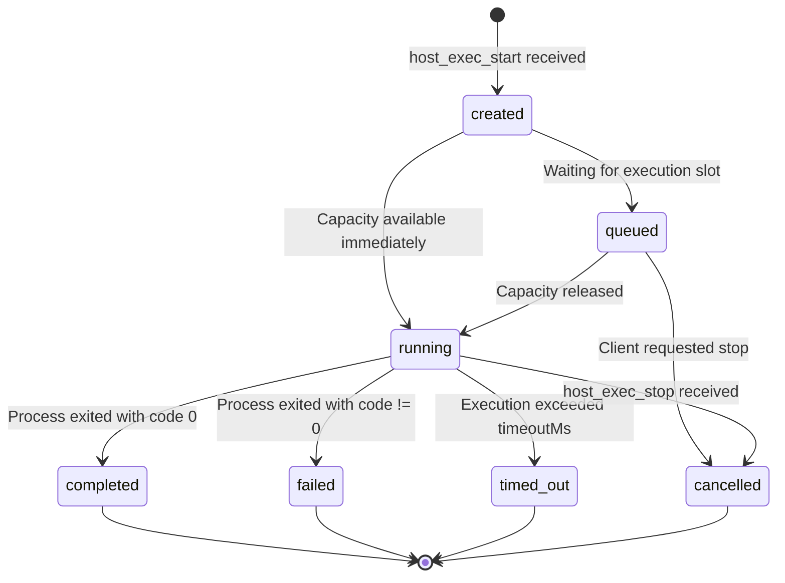

# Host Process & Sub-Agent Governor: System Architecture

## 1. System Overview

The **Host Process & Sub-Agent Governor** is a lightweight, cross-harness local execution and orchestration layer designed to run as an auxiliary service via standard Model Context Protocol (MCP) over `stdio`.

It provides two fundamental capabilities to AI agent harnesses (such as Google Antigravity, OpenAI Codex CLI, and Codex Desktop):
1. **Background Host Process Execution**: Detached, asynchronous process management with bounded output buffers, execution timeouts, safe orphan PID cleanup, and clean process-tree termination.
2. **Sub-Agent Concurrency Governance**: Strict enforcement of sub-agent concurrency limits (default: **3 sub-agents per model**), cross-instance synchronization via atomic file locking, priority queueing, and idempotency deduplication.

```
+-------------------------------------------------------------------------+
|                              Host Machine                               |
|                                                                         |
|  +---------------------------+       +-------------------------------+  |
|  |   Google Antigravity      |       |   OpenAI Codex (CLI/Desktop)  |  |
|  |  (App, IDE, agy CLI)      |       |                               |  |
|  +-------------+-------------+       +---------------+---------------+  |
|                |                                     |                  |
|     MCP stdio  | (hooks.json)            MCP stdio   |                  |
|     JSON-RPC   | PreToolUse              JSON-RPC    |                  |
|                v                                     v                  |
|  +-------------------------------------------------------------------+  |
|  |                 Host Governor MCP Server Layer                    |  |
|  |       (Zod Validation, JSON-RPC 2.0, Structured Error Codes)      |  |
|  +----------------------------------+--------------------------------+  |
|                                     |                                   |
|                +--------------------+-------------------+               |
|                v                                        v               |
|  +---------------------------+       +-------------------------------+  |
|  |      ProcessManager       |       |       SubagentGovernor        |  |
|  | - Detached spawn          |       | - Max 3 agents/model cap      |  |
|  | - ProcessTreeManager      |       | - Priority scheduling queue   |  |
|  | - BoundedRingBuffer       |       | - 60s idempotency deduplication| |
|  | - SecurityGuard           |       | - Fair FIFO with priority     |  |
|  | - Orphan PID protection   |       | - Graceful lease auto-expiry  |  |
|  +-------------+-------------+       +---------------+---------------+  |
|                |                                     |                  |
|                +--------------------+----------------+                  |
|                                     v                                   |
|  +-------------------------------------------------------------------+  |
|  |                      StateStore (Atomic Engine)                   |  |
|  |  - Local JSON state store (.governor-state.json)                  |  |
|  |  - 'wx' Lockfile with Windows EPERM/EBUSY jittered exponential    |  |
|  |    backoff (10-25ms) and stale lock recovery (4000ms TTL)         |  |
|  +-------------------------------------------------------------------+  |
+-------------------------------------------------------------------------+
```

---

## 2. Core Components

### 2.1 StateStore (`src/core/state-store.ts`)
The `StateStore` provides atomic, cross-process persistence for governor state (`.governor-state.json`):
- **Atomic Updates**: Uses atomic lockfiles (`.lock` via `flag: 'wx'`) to synchronize read-modify-write operations across multiple Harness instances.
- **Windows File Contention Handling**: Handles Windows-specific `EPERM` and `EBUSY` race conditions using exponential backoff with randomized jitter (10–25ms intervals, up to 100 retries).
- **Stale Lock Recovery**: Automatically breaks stale lockfiles older than 4,000ms if a process crashes unexpectedly while holding a lock.
- **Memory Fallback**: Seamlessly falls back to an in-memory store if disk I/O is unavailable.

### 2.2 SubagentGovernor (`src/core/subagent-governor.ts`)
The `SubagentGovernor` enforces sub-agent quotas and schedules work:
- **Concurrency Cap**: Enforces `MAX_SUBAGENTS_PER_MODEL` (default: 3 concurrent sub-agents per model family, e.g., `gemini-1.5-pro`, `gpt-4o`).
- **Priority Queue**: Supports 4 priority levels (`critical` > `high` > `normal` > `low`) with fair queue draining.
- **Idempotency Deduplication**: Tracks `idempotencyKey` within a configurable sliding window (default: 60,000ms) to ensure network/retry requests return the existing active lease without double-allocating quota.
- **Cross-Instance Synchronization**: Reads and writes active leases and waiting queues to `StateStore`, ensuring multiple Antigravity or Codex windows share the concurrency pool.

### 2.3 ProcessManager (`src/core/process-manager.ts`)
The `ProcessManager` supervises host tasks:
- **Detached Execution**: Spawns processes detached from the Node.js event loop with unref'd child handles.
- **Capacity Caps**: Enforces `MAX_ACTIVE_PROCESSES` (default: 50 concurrent host processes) to prevent host exhaustion.
- **Deterministic State Tracking**: Backed by `ProcessStateMachine` tracking state transitions (`created -> queued -> running -> completed / failed / cancelled / timed_out`).
- **Execution Timeouts**: Automatically stops tasks that exceed `timeoutMs` (defaults to unlimited; configurable per request).
- **Safe Orphan Cleanup**: Periodically audits `.governor-state.json` and host process tables. Orphan processes are only terminated if the owning governor PID is confirmed dead via OS signals, protecting active tasks owned by running sibling Harnesses. Guards against OS PID reuse.

### 2.4 ProcessTreeManager (`src/core/process-tree.ts`)
Handles cross-platform process tree discovery and termination:
- **Windows**: Executes `taskkill /pid <PID> /t` (graceful termination first with a configurable 1,500ms grace window, escalating to `taskkill /f /t` only if the tree fails to exit).
- **POSIX (Linux/macOS)**: Uses negative process group IDs (`process.kill(-pid, 'SIGTERM')` followed by `SIGKILL` after the grace period).

### 2.5 BoundedBuffer (`src/core/bounded-buffer.ts`)
Prevents memory exhaustion from long-running or verbose processes:
- **Head + Tail Ring Buffer**: Retains the first 200 lines (`headBuffer`) and a circular ring of the most recent lines (default: 1,000 lines in `tailRing`).
- **Disk Spill Support**: Optional automated spilling to a temporary disk file if stream sizes exceed threshold limits.
- **Zero Memory Leaks**: Verified by sustaining 100,000 log events with zero heap growth.

### 2.6 SecurityGuard (`src/core/security-guard.ts`)
Provides runtime security filtering:
- **Secret Redaction**: Automatically redacts Bearer tokens, OpenAI/Anthropic/Google API keys, AWS credentials, and password parameters from output streams before storage or tool responses.
- **Path Confinement**: Validates working directory arguments against configured root paths (`GOVERNOR_ALLOWED_ROOTS`) to prevent directory traversal exploits.

---

## 3. Process Execution State Machine



All state transitions are deterministic and monotonic. Invalid transitions (e.g., transitioning from `completed` to `running`) throw structured error `ERR_INVALID_TRANSITION`.

---

## 4. Sub-Agent Control Boundaries (3-Tier Reality Matrix)

External plugins cannot intercept arbitrary native threads within compiled binary runtimes. The governor establishes three distinct operational tiers:

| Tier | Category | Mechanism | Enforcement Level |
|---|---|---|---|
| **Tier 1** | **Directly Managed Sub-Agents** | Agent calls `governor_acquire_slot` / `governor_release_slot` via MCP | **100% Deterministic**: Slot requests exceeding limit are queued or rejected immediately. |
| **Tier 2** | **Harness-Mediated Invocations** | Antigravity `PreToolUse` hook intercepts `invoke_subagent` calls | **Harness-Guaranteed**: Hook returns `{ decision: "deny" }` when quota is exhausted, blocking execution. |
| **Tier 3** | **Uninstrumented Internal Threads** | Internal Harness threads spawned without MCP or hook triggers | **Outside Plugin Boundary**: Documented architectural limit of external MCP servers. |

---

## 5. High-Availability & Concurrency Safety

1. **Windows Lockfile Race-Free Guarantee**:
   The `flag: 'wx'` mode in `fs.promises.writeFile` provides atomic creation at the Windows kernel level. If another process holds the lock, the operation fails immediately with `EEXIST`, triggering jittered exponential backoff rather than blocking the Node.js event loop.
2. **Stale Lock Recovery**:
   If a Harness process is abruptly killed (`SIGKILL` or power outage), the lockfile contains the owning PID and a millisecond timestamp. Subsequent processes verify if the lock age exceeds 4,000ms and whether the owning PID is alive. If dead, the lock is broken safely.
3. **Graceful Escalation**:
   Process termination always begins with cooperative signals (`WM_CLOSE`/`SIGTERM`) giving processes 1,500ms to flush buffers and close file handles before force-killing (`/f` / `SIGKILL`).
4. **Safe Orphan Cleanup & PID Reuse Protection**:
   `cleanOrphanProcesses` inspects registered child processes on startup. A process is only considered for cleanup if its parent governor PID is verified dead via OS signal checks (`ProcessTree.isAlive(parentPid)`). Furthermore, `ProcessTree.verifyProcessSignature` validates that the running child executable image matches the recorded command name, guaranteeing that recycled OS PIDs belonging to other system applications are never terminated.
